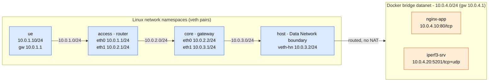

# 5G-project-RTU

**Project 1: Network Deployment, Measurement, and Observability — Scenario A: Software-Based Telecommunications Network**

A university project that examines the deployment and operation of a software-based
telecommunications network from the perspective of a network engineer. The goal is to
establish an operational end-to-end path, observe how traffic behaves across the
system, quantify service performance under controlled conditions, and explain normal
operation and degradation with packet-, system- and application-level evidence.

> **Workflow:** Deploy → Verify → Observe → Measure → Diagnose → Explain

---

## Contents

- [Architecture](#architecture)
- [Technology Stack](#technology-stack)
- [Repository Structure](#repository-structure)
- [Prerequisites](#prerequisites)
- [Quickstart](#quickstart)
- [Project Status & Activity Log](#project-status--activity-log)
- [Documentation](#documentation)

---

## Architecture

Scenario A is a **hybrid Linux + Docker** network running on a single Linux VM.
Linux network namespaces implement the UE, the access router and the core/gateway;
a Docker user-defined bridge extends the Data Network toward containerised services.
The path is **fully routed (no NAT)** so that captures show real end-to-end addresses.



**Routing in one line:** `ue` defaults to the access router; `access` and `core`
forward the `10.0.4.0/24` service network onward; the host routes the return path
`10.0.1.0/24` back through core. IP forwarding is enabled in `access`, `core` and the
host. Full addressing and routing tables are in
[`docs/addressing-plan.md`](docs/addressing-plan.md).

## Technology Stack

| Category | Technology | Purpose |
|---|---|---|
| Network isolation | Linux network namespaces (`ip netns`) | UE, access router, core/gateway |
| Virtual links | veth pairs | Point-to-point links between namespaces |
| Containerisation | Docker + user-defined bridge | Data Network extension and service hosting |
| Application service | Nginx (official image) | HTTP server on `10.0.4.10:80` |
| Measurement endpoint | `networkstatic/iperf3` | TCP/UDP throughput endpoint on `10.0.4.20:5201` |
| Traffic generation | `ping`, `curl`, `iperf3` | ICMP, HTTP and TCP/UDP tests |
| Capture & analysis | `tcpdump`, `tshark` | Multi-point packet evidence |
| Impairment | Linux `tc` + NetEm | Controlled delay, loss and bandwidth limits |
| Routing & addressing | `iproute2` (`ip`) | Interfaces, routes, forwarding |
| Plotting | Python 3 + `matplotlib` | Comparative tables and plots |

## Repository Structure

```
5G-project-RTU/
├── README.md
├── docs/                     # plans and step reports
├── scripts/
│   ├── deploy/               # setup.sh, verify.sh
│   ├── observe/              # capture.sh, analyze.sh   (Step 2)
│   ├── measure/              # impair.sh, measure.sh, run-all.sh, plot.py (Step 3)
│   └── teardown/             # cleanup.sh
├── captures/                 # raw .pcap files (git-ignored)
└── results/                  # raw outputs, dissections, tables and plots
```

## Prerequisites

- Linux VM (Ubuntu) with root/sudo access.
- `iproute2` (provides `ip` and `tc` with NetEm).
- Docker Engine (user-defined bridge networks and containers).
- `iperf3`, `tcpdump`, `tshark`, `curl`, `ping`; optional `python3` + `matplotlib`.

```bash
sudo apt update
sudo apt install -y iproute2 iputils-ping iperf3 tcpdump tshark curl python3 python3-pip
# Docker Engine: https://docs.docker.com/engine/install/
```

## Quickstart

```bash
git clone <repository-url> && cd 5G-project-RTU

sudo ./scripts/deploy/setup.sh       # build namespaces, veths, routes, Docker services
sudo ./scripts/deploy/verify.sh      # end-to-end checks (ICMP, HTTP, iperf3)

sudo ./scripts/measure/run-all.sh    # baseline + degraded measurement set
python3 ./scripts/measure/plot.py    # comparative table + plots

sudo ./scripts/teardown/cleanup.sh   # remove namespaces, links and containers
```

## Project Status & Activity Log

| Step | Description | Status | Evidence |
|---|---|---|---|
| 0 | Repository scaffold, addressing plan, deploy/verify/teardown scripts | ✅ Done | `docs/addressing-plan.md`, `scripts/` |
| 1 | Network deployment and end-to-end operation | ✅ Done | `docs/step1-network-deployment.md`, `results/step1/` |
| 2 | Traffic observation and protocol behavior | ✅ Done | `docs/step2-traffic-observation.md`, `results/step2/`, `captures/step2/` |
| 3 | Performance measurement and network degradation | ✅ Done | `docs/step3-performance-measurement.md`, `results/step3/` |

| Date | Activity | Outcome |
|---|---|---|
| 2026-09-21 | Repository scaffold and addressing plan (10.0.1–10.0.4.0/24 scheme) | `docs/addressing-plan.md` |
| 2026-09-21 | Deploy / verify / teardown scripts | `scripts/deploy/`, `scripts/teardown/` |
| 2026-09-21 | **Step 1** — topology deployed on the lab VM; Docker 29 hardened forwarding diagnosed and fixed (`allow-direct-routing` + `DOCKER-USER`); path verified (HTTP 200, iperf3 ≈ 36 Gbit/s) | `docs/step1-network-deployment.md`, `results/step1/` |
| 2026-09-22 | **Step 2** — six-point captures (ICMP/TCP/UDP/HTTP) and tshark dissection; AppArmor `tshark` confinement worked around with `aa-exec` | `docs/step2-traffic-observation.md`, `results/step2/`, `captures/step2/` |
| 2026-09-22 | **Step 3** — baseline + delay/loss/rate conditions with NetEm; comparative table and plots | `docs/step3-performance-measurement.md`, `results/step3/` |

## Documentation

| Document | Contents |
|---|---|
| [`docs/addressing-plan.md`](docs/addressing-plan.md) | Subnet relationships, interface/IP addressing, routing plan |
| [`docs/step1-network-deployment.md`](docs/step1-network-deployment.md) | Deployment, end-to-end verification, path analysis, Docker diagnosis |
| [`docs/step2-traffic-observation.md`](docs/step2-traffic-observation.md) | ICMP/TCP/UDP/HTTP packet-level observation across six capture points |
| [`docs/step3-performance-measurement.md`](docs/step3-performance-measurement.md) | Baseline and degraded-condition performance study |
| [`docs/final-report.md`](docs/final-report.md) | Final report skeleton, requirement coverage and evidence index |
