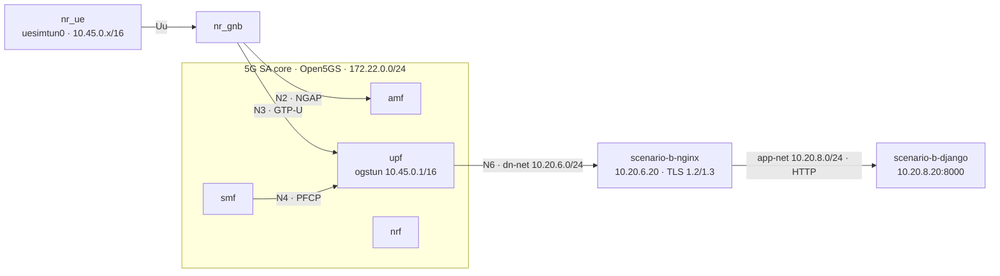
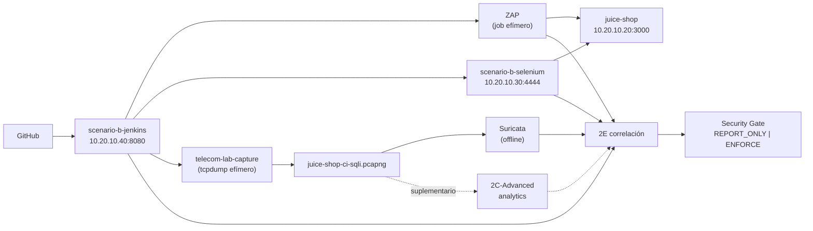

# Architecture and phases

What the system is, how the pieces connect, and what each phase is supposed to
prove. Operational commands live in the [README](../README.md); the checks and
their evidence live in [verification.md](verification.md).

Workflow mnemonic from the brief:
**Reuse → Secure → Model → Test → Detect → Automate → Analyze → Defend.**

## Scenario A — secure application over the real 5G user plane

Scenario A reuses the Project 1 5G Standalone network and adds a Django
application behind an Nginx TLS gateway. The point is not the web app: it is
that the request really crosses the 5G user plane and that the application is
protected at every layer on the way.



Design decisions that the phase gates enforce:

- **Nginx is the only bridge** between `dn-net` and `app-net`. Django is never
  attached to `dn-net`, so the telecom data plane never touches the application
  directly. `app-net` is an `internal` Docker network.
- **The UE route is narrow**: only `10.20.6.0/24 dev uesimtun0`, never a
  `default` route. Traffic for the application enters the PDU tunnel; everything
  else keeps using the management path.
- **TLS terminates at the gateway**, with a lab PKI: Root CA → server
  certificate with `SAN IP:10.20.6.20`. The CA private key stays on the host and
  is mounted into no container. Inside `app-net` the traffic is plain HTTP with
  `X-Forwarded-Proto: https`.
- **The UE trusts the CA** at `/etc/telecom-lab/ca.crt`, so certificate
  validation is real (`--cacert`), never `-k`.

## Scenario B — security validation layer

Scenario B is a security-engineering extension beside the working Scenario A,
not a second 5G network. Juice Shop is deliberately vulnerable and isolated on
`security-net`; it is a positive control, not a service. The tools are CI jobs
orchestrated by Jenkins, never network functions.



Two ideas hold the whole scenario together:

- **Positive controls.** ZAP Alert 40018 and Suricata SID 1000001 are expected to
  fire against a known-vulnerable target. Detecting them proves the *mechanism*
  works; it says nothing about whether an application is secure.
- **Three separate layers.** Tool result (did it run), security finding (what it
  observed) and gate decision (policy) are reported separately. A green build is
  not a security verdict.

## Addresses and components (working specification)

| Item | Value |
|---|---|
| UE PDU pool | `10.45.0.0/16` (`uesimtun0`) |
| 5G core / N2-N3-N4-SBI | `docker_open5gs_default` `172.22.0.0/24` |
| N6 / data network | `dn-net` `10.20.6.0/24`; `scenario-b-nginx` at `10.20.6.20` |
| Private application network | `app-net` `10.20.8.0/24` (internal); Django `10.20.8.20:8000`, Nginx `10.20.8.10` |
| Security test network | `security-net` `10.20.10.0/24`; Juice Shop `.20:3000`, Selenium `.30:4444`, Jenkins `.40:8080` |
| Lab PKI | local root CA; server cert with `SAN = IP:10.20.6.20` |
| TLS policy | TLS 1.2/1.3, `HTTP:80 → 301 → HTTPS:443` |
| UE image (Project 2) | `telecom-lab-ueransim:3.3.0-p2` (UERANSIM 3.3.0) |
| App images | `telecom-lab-nginx:p2`, `telecom-lab-django:0.1` |
| Security images | `juice-shop:v20.2.0`, `telecom-lab-selenium:1.0`, `jasonish/suricata:8.0`, `aquasec/trivy:0.75.0`, `anchore/syft:v1.52.0` |

### Reproducibility debt (documented, not fixed)

`project2/scenario-a/nginx/Dockerfile` builds on `FROM nginx:latest` and the
Django image on `FROM python:3.12-slim`. Both are mutable tags: the same
Dockerfile can produce different bytes tomorrow. Everything else is
version-pinned in `RELEASE-MANIFEST.json`, so this is the remaining hole in the
reproducibility story — and the 2D counts attributed to
`telecom-lab-nginx:p2` are only comparable if the base image behind that tag
does not change.

Observed on 2026-11-16: `nginx:latest` resolved to nginx 1.31.8, created
2026-11-05, digest `sha256:165ddde8751e75a1c907d24ef10d9f6deb08b57e0fe56caf67512486aff76d82`.

Decision: **revisit once every phase is verified**. The fix is to pin
`nginx:<version>@sha256:…` and a `python:3.12-slim@sha256:…` digest in the
Dockerfile and the release manifest, with a written bump policy (manual review
when Trivy flags a new base-image CVE). Pinning does not reduce CVEs by itself;
it makes the evidence reproducible. Multi-arch caveat: pin the manifest-list
digest, not the platform `RepoDigest`.

## Phase map

Each phase answers one question and leaves machine-readable evidence. The
right-hand column matters as much as the middle one: it is what you must not
claim.

| Phase | Question it answers | Evidence | Does **not** prove |
|---|---|---|---|
| 1A | Does the UE have a PDU session, and does traffic to N6 leave through `uesimtun0`? | `verify-phase1a.sh`; route survives a container restart | Anything about the application |
| 1B | Is Django healthy, alone on `app-net`, with a persistent database? | `verify-phase1b.sh`; `/health/` body | TLS, authentication, segmentation from the outside |
| 1C | Is the gateway presenting a valid certificate and real TLS? | `verify-phase1c.sh`; SAN, 301→200, 1.2/1.3, `--cacert` | That the application itself is protected |
| 1D | Are authentication, authorization, CSRF, cookies and headers enforced? | `verify-phase1d.sh`; 302/200, 200/403, cookie flags | Transport security, packet-level behaviour |
| 1E | Does the whole path work from inside the UE? | `verify-phase1.sh`; real `10.45.0.x` in the gateway log | That the application is free of vulnerabilities |
| 2A | Is the security environment ready and clean? | `preflight.json` (Jenkins, images, capture visibility, SID loaded, fresh RUN_ID) | Anything about the target |
| 2B | Do the scanners see the application and react to a controlled attack? | ZAP baseline, Selenium JSON, `capture.json`, Alert 40018 | That the target is secure |
| 2C | Is the PCAP from this run, and does the IDS see the payload? | `phase2c.json`, `eve.json`, `fast.log`, SID 1000001 | Why the application is vulnerable |
| 2C-Advanced | Can packet observations be turned into features and ranked anomalies? | `traffic-features.csv`, `traffic-anomaly.json`, `traffic-classification.json` | Detection accuracy (bounded demo) |
| 2D | Which components are present, and which known vulnerabilities do they carry? | Trivy report, CycloneDX SBOM | Whether those CVEs are exploitable here |
| 2E | Do the independent observations describe the same event, and what does policy say? | correlation JSON/MD, archive, `gate.json/.md` | That the target is secure or that the pipeline is complete |

## Why the start order is not negotiable

```text
deploy.sh → enable-n6.sh → upgrade-ran.sh → up.sh → verify-phase1.sh
```

- `deploy.sh` starts the UPF **without** the `dn-net` override and brings the UE
  up before N6 exists.
- `enable-n6.sh` recreates the UPF with `dn-net` and without NAT, and recreates
  the inherited `sb-nginx` on `10.20.6.20`.
- Because the UPF was recreated, the UE must register again
  (`upgrade-ran.sh`). Doing it in the other order leaves a dead PDU session:
  the symptoms are `UE cannot reach 10.20.6.20` and a gateway log with no
  request from `10.45.0.x`.
- `up.sh` removes `sb-nginx` (same IP as `scenario-b-nginx`) and starts the
  application layer.

Scenario B has no dependency on that order. It only requires the Scenario A
gate (1E) to be green, because Preflight re-runs it as its first check.
