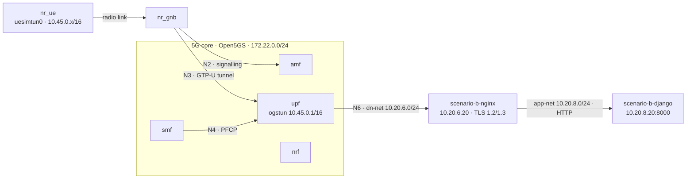
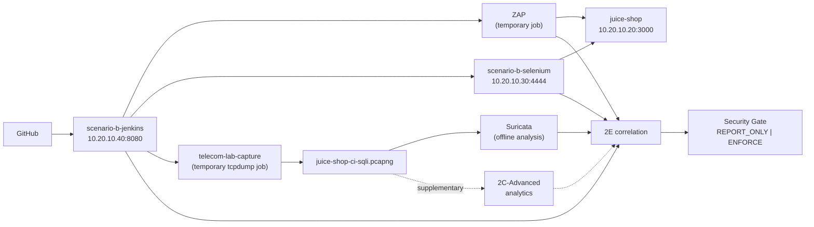
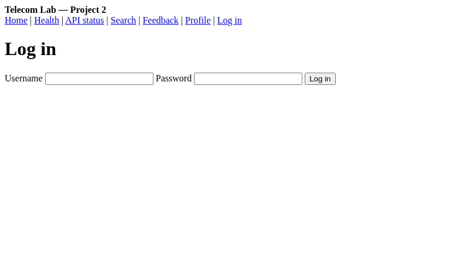
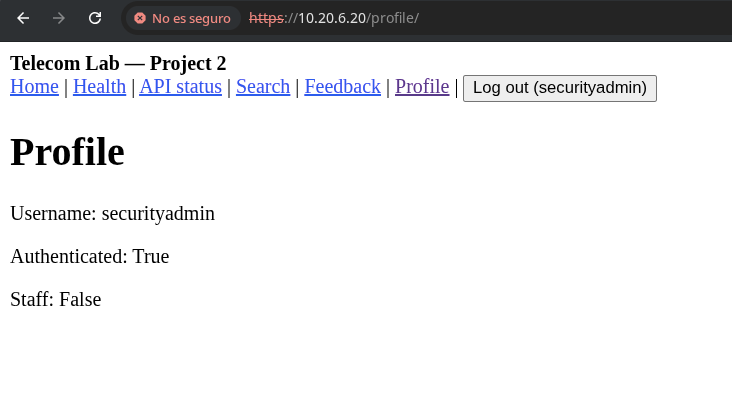
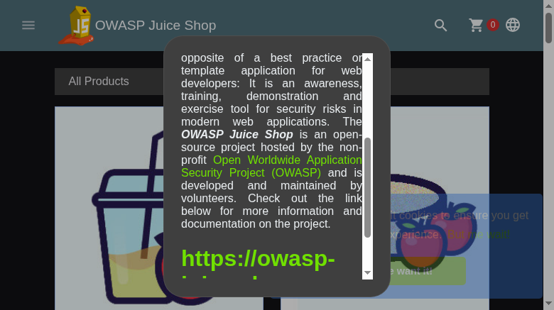
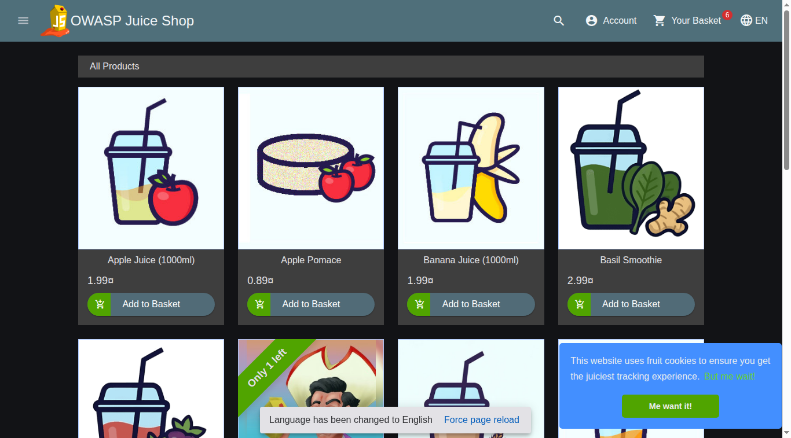
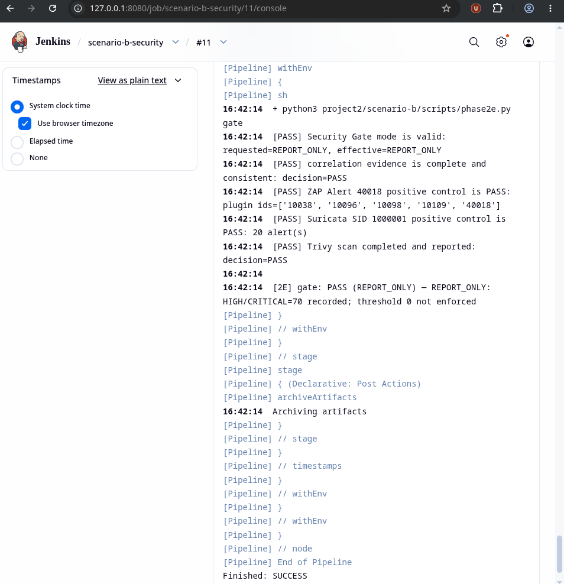
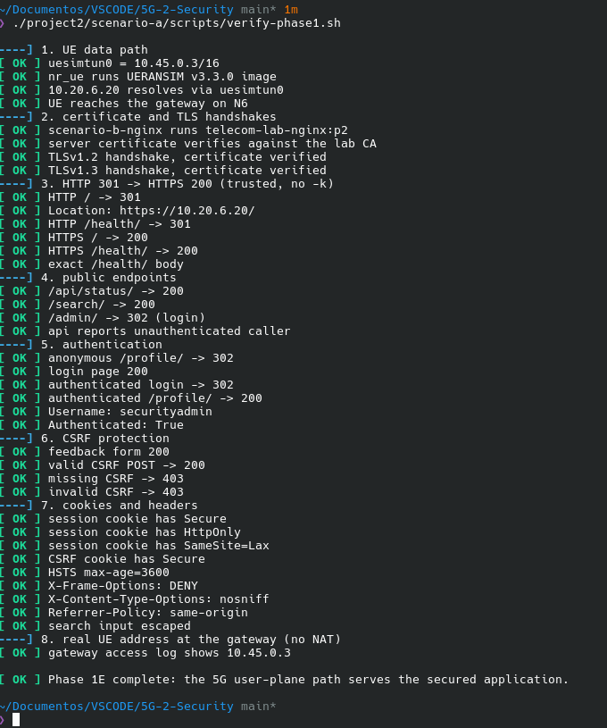
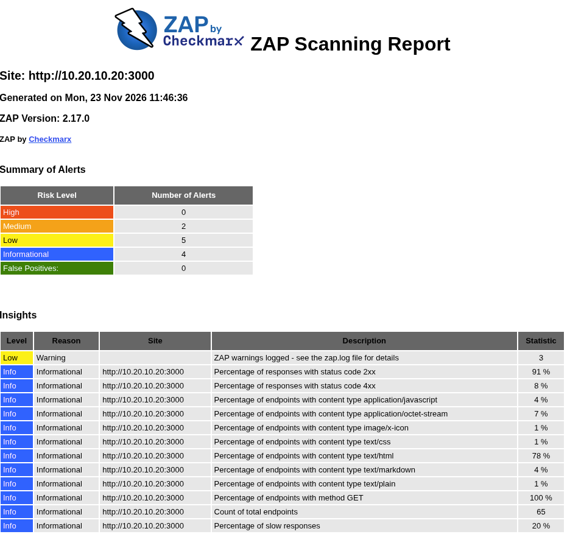

# Project 2 — Telecommunication Security, DevSecOps and Traffic Intelligence

**What this system does, how to use it, and what it proves.**

This document is written so that it can be read without prior knowledge of 5G or
security engineering. Technical terms appear in **bold** the first time and are
explained in the [glossary](#14-glossary). If you only want to run the lab, jump
to [§7](#7-guided-walkthrough-run-it-yourself); if you want the results, go to
[§10](#10-results-what-was-measured).

Companion documents: [architecture](architecture.md) (design reference),
[verification](verification.md) (checks and evidence), [README](../README.md)
(day-to-day commands).

> **Where the numbers come from.** Every figure was produced by a real execution,
> reproducible with the command next to it. The authoritative end-to-end
> reference is Jenkins build 17 (2026-11-23, run `20261123T114855Z`,
> `REPORT_ONLY`, `SUCCESS`), which includes the 2C-Advanced stage; §10 also
> quotes build 16, the same pipeline in `ENFORCE`. Earlier builds are kept in
> [verification.md](verification.md) as history, not as current figures.

---

## 1. The project in one page

Imagine a small online service. Two questions decide whether it is safe to use:

1. **Can someone on the network read or modify what travels between the user and
   the service?**
2. **Once the request arrives, is the service allowed to trust it, and is the
   user allowed to do what they are asking?**

This project answers both questions in a laboratory built on a real **5G**
network, and then goes one step further: it **attacks a deliberately vulnerable
application on purpose**, captures the attack at the packet level, detects it,
and lets a **CI/CD pipeline** decide whether the result is acceptable.

So there are two halves:

- **Scenario A — the protected path.** A web application (Django) is published
  through a **TLS** gateway (Nginx) and is only reachable through the 5G network,
  as if it were a service on a mobile operator's data network. Everything is
  encrypted, segmented, and requires a login.
- **Scenario B — the security laboratory.** A separate, intentionally broken shop
  (OWASP Juice Shop) is attacked by automated tools, recorded, analysed, and the
  results are correlated into one **evidence** set that a **Jenkins** pipeline
  turns into a pass/fail decision.

The two halves are connected by one rule: **the laboratory never touches the
protected application.** They live on different networks, and that separation is
itself one of the things being verified.

### Why the pipeline does not say "the app is secure"

The shop being attacked is *supposed* to be vulnerable. When a tool finds a known
weakness there, that is a **positive control**: it proves the detector works. A
green build therefore means *"the checks ran, the detectors fired, the evidence
belongs to this run, and policy allowed it"* — not *"this application is safe"*.
Confusing those two statements is the most common way a security pipeline lies.

## 2. Index of components

| Piece | In plain words | In this lab |
|---|---|---|
| **UE** | The phone (simulated) | `nr_ue`, gets an address `10.45.0.x` inside the 5G tunnel |
| **gNB** | The 5G base station (simulated) | `nr_gnb`, connects the phone to the core |
| **5G core** | The operator's brain: who you are, whether you may connect, where your traffic goes | Open5GS functions: `amf`, `smf`, `upf`, `nrf`, `ausf`, `udm`, `udr`, `pcf`, `bsf`, `nssf`, `scp` |
| **UPF** | The gateway that connects the mobile network to the internet/data network | `upf`, tunnel address `ogstun 10.45.0.1/16` |
| **N6** | The "data network" side, where services live | Docker network `dn-net`, `10.20.6.0/24` |
| **Nginx** | The doorman: terminates encryption and forwards requests inward | `scenario-b-nginx` at `10.20.6.20`, TLS 1.2/1.3 |
| **Django** | The application itself | `scenario-b-django` at `10.20.8.20:8000`, only on the private network |
| **PKI / CA** | The lab's own certificate authority, so encryption can be *verified*, not just enabled | Root CA + server certificate with the gateway's IP in its **SAN** |
| **Juice Shop** | A shop built to be broken, used as a target | `juice-shop` at `10.20.10.20:3000`, isolated on `security-net` |
| **Jenkins** | The conductor: runs every stage in order and records the result | `scenario-b-jenkins` at `10.20.10.40:8080` |
| **ZAP** | An automated web-security scanner | runs as a temporary container per test |
| **Selenium** | A real browser driven by code | `telecom-lab-selenium:1.0` |
| **tcpdump / PCAP** | A recorder of network packets | ephemeral capture container writing `juice-shop-ci-sqli.pcapng` |
| **Suricata** | An **IDS**: reads traffic and raises alerts on known patterns | analyses the PCAP **offline** |
| **Trivy / Syft** | A vulnerability scanner and an inventory generator | `aquasec/trivy:0.75.0`, `anchore/syft:v1.52.0` |
| **Gate** | The policy decision at the end | `REPORT_ONLY` or `ENFORCE` |

## 3. How the pieces fit

### 3.1 Scenario A — the protected path



The phone talks to the base station; the base station
sends user traffic through an encrypted tunnel (**GTP-U**) to the **UPF**; the
UPF hands it to the data network; the doorman (Nginx) decrypts it and only then
speaks to the application. Django is **not** attached to the data network: it can
only be reached through the doorman. That is what "segmented" means in practice.

### 3.2 Scenario B — the security laboratory



The pipeline order is a contract:

```text
1E → 2A → 2B-1 ZAP baseline → 2B-2 Selenium → 2B-3 arm capture
   → 2B-4 controlled SQL injection → 2B-5 targeted ZAP → 2C stop/validate PCAP
   → 2C Suricata → 2C-Advanced analytics → 2D Trivy → 2D Syft
   → 2E correlation → archive → gate
```

Why this order and not another:

- **The environment is checked first.** A security result produced in an
  unprepared environment cannot be interpreted: maybe the scanner pointed at the
  wrong host, or the capture was never watching the right interface.
- **The recorder starts before the attack.** A capture started afterwards would
  contain everything except the attack.
- **The network analysis reads a file.** Suricata is not in the traffic path; it
  examines the recording, so the result is reproducible.
- **Only at the end does anything decide.** The decision is policy, separate from
  what the tools found.

## 4. The life of one request

This is the story the project is really about. A request starts inside the
simulated phone:

1. The application asks the operating system to connect to `10.20.6.20`.
2. The routing table says that address belongs to `uesimtun0` — the **PDU
   session** tunnel. Nothing else is routed into 5G; ordinary traffic still uses
   the normal management path.
3. The packet is encapsulated in **GTP-U** and sent to the **UPF**.
4. The UPF removes the encapsulation and forwards the packet on the data network
   (`dn-net`), where the source address is the phone's `10.45.0.x` — not a
   translated one. This matters: the server must be able to see who really
   called.
5. Nginx accepts the **TLS** connection, proves its identity with a certificate
   signed by the lab's CA, and decrypts the request.
6. Nginx forwards it over the private network (`app-net`) to Django, adding a
   header that says the original request was HTTPS.
7. Django checks the session cookie, the CSRF token and the permissions, and
   answers.
8. The answer travels back the same way. The gateway writes a log line with the
   real `10.45.0.x` address — that line is one of the proofs this project
   requires.

Every step above is asserted by a script. If any link is broken, the final gate
fails and says which link.

## 5. Scenario A, step by step

### 5.1 What was built

| Phase | What it adds | What you can see |
|---|---|---|
| 1A | The 5G path with a **narrow route** installed by the UE image | `uesimtun0 = 10.45.0.x`, `10.20.6.20 via uesimtun0` |
| 1B | The application on a private network, with a persistent database | `/health/` answers; the database survives recreating the container |
| 1C | The TLS doorman with a lab certificate | `https://10.20.6.20` works and the certificate validates |
| 1D | Login, permissions, CSRF protection, secure cookies, security headers | `/profile/` requires a session; `/feedback/` rejects a POST without token |
| 1E | All of the above, exercised from inside the phone | `[ OK ] Phase 1E complete` |

### 5.2 What it looks like

The application served through the TLS gateway:



The same application after logging in (this is what phase 1D proves: the page
only renders for an authenticated session, and it shows the identity the server
accepted):



The browser warns "Not secure" because the lab CA was never installed in it; the
certificate chain is validated where it counts, with `curl --cacert` in 1C and
1E, not by a browser icon.

The shop used as the attack target in Scenario B — deliberately vulnerable and
isolated from the application above:



## 6. Scenario B, step by step

| Stage | What it does | Why it is not redundant |
|---|---|---|
| 2A Preflight | 35 checks that the environment is ready and clean | A result from a dirty environment is not evidence |
| 2B-1 ZAP baseline | Passive scan: what the shop exposes | Finds surface without attacking |
| 2B-2 Selenium | A real browser logs in, and we inspect the session | Passwords, tokens and cookies only exist at runtime |
| 2B-3/4 Capture + controlled SQL injection | Recorder armed, then one crafted request | Produces network evidence of a known attack |
| 2B-5 Targeted ZAP | Confirms the SQL-injection rule (alert 40018) fires | Application-level detection |
| 2C Suricata | Reads the recording and matches rule 1000001 | Network-level detection of the same event |
| 2C-Advanced | Turns packets into features, clusters and anomaly scores | Shows analysis, explicitly marked supplementary |
| 2D Trivy + Syft | Vulnerabilities in images and a full component inventory | Artifacts, not behaviour |
| 2E Correlation + gate | Ties every observation to one run and decides | The only place a policy decision exists |

Two screenshots of the laboratory in action:

The browser session driven by Selenium, authenticated inside Juice Shop:



The end of a Jenkins run — console of build 11, gate `PASS` in `REPORT_ONLY`,
`Finished: SUCCESS`:



*(The stage graph — 1E → 2A → 2B → 2C → 2C-Advanced → 2D → 2E — is still
pending as a screenshot: `docs/images/stage-graph.png`.)*

## 7. Guided walkthrough: run it yourself

This is the shortest path from a cold machine to a gate decision. It assumes the
one-time setup from the [README](../README.md) is done.

### Step 1 — start the lab

```bash
cd ~/5G-2-Security
./host-up.sh            # Scenario A only
# or: ./host-up.sh --with-b   # also Jenkins, ZAP target and Selenium
```

The wrapper starts the core, attaches the data network, rebuilds the radio with
the narrow route, starts the application and finally runs the acceptance gate.
If a prerequisite is missing it stops and tells you the exact command.

### Step 2 — accept Scenario A

```bash
./project2/scenario-a/scripts/verify-phase1.sh
```

Expected: every line starts with `[ OK ]`, and the last one is
`[ OK ] Phase 1E complete: the 5G user-plane path serves the secured application.`
with exit code 0.



### Step 3 — run the security pipeline

```bash
SECURITY_GATE_MODE=REPORT_ONLY ./project2/scenario-b/scripts/run-pipeline.sh
```

Expected tail (build 17, run `20261123T114855Z`):

```text
[preflight] PASS — 0 failed of 35
[2B] summary: PASS — 0 failed of 23
[2C] phase2c: PASS — 0 failed of 12
[2C-Advanced] analytics: PASS — 0 failed of 10; controlled request FLAGGED
[2D] phase2d: PASS — 0 failed of 14
[2E] correlate: PASS — 0 failed of 5
[2E] archive: PASS — 0 failed of 7
[2E] gate: PASS (REPORT_ONLY) — HIGH/CRITICAL=70 recorded; threshold 0 not enforced
```

The `correlate` checks (5, or 6 when the image still has to be built) are the
wrapper around the image; the correlation itself runs inside it and reports
`0 failed of 22` in `security-event-correlation.json`.

### Step 4 — look at the evidence

Everything a run produces lands in `results/scenario-b/<phase>/<RUN_ID>/`. Start
with the two positive controls and the decision:

```bash
R=$(ls -d results/scenario-b/phase2e/*/ | tail -1)
jq '.chain, .decisions' "$R/security-event-correlation.json"
jq '.mode, .security_finding, .decision' "$R/gate.json"
```

Open the reports in a browser:

- `results/scenario-b/phase2b/<RUN_ID>/zap-baseline-report.html`
- `results/scenario-b/phase2b/<RUN_ID>/selenium-authenticated.png`
- `results/scenario-b/phase2e/<RUN_ID>/security-event-correlation.md`

The ZAP report header, with its alert count:



The header is a **summary**. Each alert below it carries `instances[]` with
`uri`, `param`, `attack` and `evidence`, and that is where the proof lives: the
targeted scan records Alert 40018 with `uri=/rest/user/login`, `param=email`,
`attack='` and `evidence="HTTP/1.1 500 Internal Server Error"`. The baseline is
passive by design, so its instances have an empty `attack` — it observes, it
does not attack; the active payload comes from `security/zap/plan.yaml`, which
is why 2B runs both.

### Step 5 — see the policy work

```bash
SECURITY_GATE_MODE=ENFORCE ./project2/scenario-b/scripts/run-pipeline.sh
```

The build now **fails at the last stage**, on purpose (build 16 in this
repository): `ENFORCE: HIGH/CRITICAL=70 exceeds threshold 0`. Nothing upstream
changed — the same evidence, a different policy. That difference is the whole
point of keeping findings and decisions separate.

### If something goes wrong

| Symptom | Usual cause | Fix |
|---|---|---|
| `UE cannot reach 10.20.6.20` | The UPF was recreated after the UE connected | Re-run `upgrade-ran.sh` (the wrapper does this in order) |
| `Address already in use 10.20.6.20` | The old gateway is still holding the address | The wrapper removes `sb-nginx` and `scenario-b-nginx` before N6 |
| Preflight fails on plugins | It was run outside the Jenkins container | Run it inside Jenkins; outside, it fails by design |

## 8. What each phase proves — and what it does not

| Phase | Proves | Does not prove |
|---|---|---|
| 1A | The phone has a session and application traffic uses the tunnel | Anything about the application |
| 1B | The application is healthy and isolated on a private network | That encryption or login work |
| 1C | Encryption is real and the certificate validates | That the application enforces permissions |
| 1D | Login, permissions, CSRF and cookie protections are enforced | Anything about transport or the network |
| 1E | The whole path works from inside the phone | That there are no vulnerabilities |
| 2A | The laboratory is ready, clean and pointed at the right target | Anything about the target |
| 2B | The scanners see the application and react to a controlled attack | That the shop is secure (it is not) |
| 2C | The same attack is visible in packets and detected by rule | That no other attacks exist |
| 2C-Advanced | Packets can be turned into features and ranked | Detection accuracy |
| 2D | What components exist and what CVEs are known | Whether those CVEs are exploitable here |
| 2E | The observations describe the same event, and policy decides | That the target is secure |

### 8.1 The verifications behind each row

The table above says what each phase proves; this one says how. Counts are those
of build 17 (`20261123T114855Z`) and every check name, status and observed value
is stored in the phase JSON — the report does not restate a number that cannot
be traced to a file. The full per-check list is in
[verification.md § What each stage actually checks](verification.md#what-each-stage-actually-checks).

| Phase | Checks | The verifications, in one line | Evidence |
|---|---|---|---|
| 1E | 38 | PDU session and route via `uesimtun0`, TLS 1.2/1.3 validated against the lab CA, 301→200, login, CSRF accepted/rejected, cookie flags, real `10.45.0.x` in the gateway log | `baseline-1e.txt` |
| 2A | 35 | Fresh run directory, 62 pinned plugins against the manifest, networks, controlled target, Selenium/ZAP/Suricata/Trivy/Syft ready, SID 1000001 loaded, required scripts present | `preflight.json` |
| 2B | 23 | ZAP baseline (5): target reachable, report parses, 11 alert records. Selenium (9): login, JWT 717 chars, 3 cookies, token in storage, authenticated 200. Capture (9): capture running first, request inside the window, hash match, alert 40018 | `phase2b.json`, `capture.json`, `selenium.json` |
| 2C | 12 | PCAP of this run only (hash and creation time), tshark parse, controlled payload, Suricata exit 0, `eve.json`/`fast.log`/`stats.log`, SID 1000001 fired (44 events, 20 stored) | `phase2c.json` |
| 2C-Advanced | 10 | Feature variance, 3 non-empty clusters, learned baseline, 4 artifacts, marked supplementary | `analytics.json` |
| 2D | 14 | Trivy image scan parses and counts severities, filesystem misconfig scan, both own images scanned, CycloneDX SBOM with components | `phase2d.json` |
| 2E | 5 + 22 + 7 + 5 | Wrapper (5, or 6 when it builds the image) around the correlation image, correlation (22) of identity/hash/window across all phases, archive (7) of 56 members, gate (5) of mode and controls | `correlate.json`, `security-event-correlation.json`, `archive.json`, `gate.json` |

Three properties are worth naming because they are what makes the numbers mean
something: every component has to report the same `RUN_ID` **and** the same
Jenkins build tag; 2B and 2C have to reference the same PCAP SHA-256; and the
positive controls (ZAP 40018, Suricata SID 1000001) have to fire, so a detector
that silently broke cannot look like a clean run.

## 9. Controls, and the attack each one addresses

| Control | Attack it addresses | Where it is proven |
|---|---|---|
| HTTPS with a validated certificate chain | Eavesdropping and credential theft on the path | 1C, 1E |
| Network segmentation (`app-net` internal, application not on the data network) | Lateral movement from the network into the application | 1B, 1E (and a negative control: the phone cannot reach Django directly) |
| Authentication separate from authorization | Anonymous access to protected pages | 1D |
| CSRF tokens | A malicious site making the user's browser perform actions | 1D (200 with token, 403 without, 403 with a forged one) |
| Cookie flags and security headers | Cookie theft, protocol downgrade, clickjacking, content sniffing | 1D |
| Fresh evidence and hashes per run | Reusing an old capture as today's proof | 2A, 2C, 2E |
| Positive controls (ZAP 40018, Suricata 1000001) | A broken detector that looks like a clean result | 2B, 2C |
| Analytics marked supplementary by construction | A model verdict opening or closing the gate | 2C-Advanced, 2E |

## 10. Results: what was measured

Quoted from the real Jenkins build 17 (`20261123T114855Z`, `REPORT_ONLY`,
`SUCCESS`); the policy row adds build 16, the same pipeline in `ENFORCE`.

| Measurement | Value | Where it comes from |
|---|---|---|
| Checks executed | 171 in total: 38 in 1E, 111 printed by stages 2A–2E, 22 inside the correlation container — 0 failed | phase JSONs, `baseline-1e.txt` |
| Preflight | 35/35 checks, 62 Jenkins plugins pinned | `preflight.json` |
| ZAP baseline | 5/5 checks, 11 alert records | `phase2b.json` |
| Selenium | 9/9 checks, JWT 717 chars, 3 cookies, screenshot 307,226 bytes | `selenium.json` |
| Capture + SQL injection | 9/9 checks, alert 40018 detected, PCAP 2,163,712 bytes, window 29.23 s | `capture.json` |
| PCAP | 835 packets, SHA-256 `ab210712…` | `phase2c.json` |
| Suricata | 44 events for rule 1000001 (`alerts_by_signature`); the JSON stores a 20-event sample and the gate prints both numbers | `eve.json`, `phase2c.json` |
| Traffic intelligence | 135 requests, 64 flows, baseline 38, 98 flagged, controlled request flagged | `traffic-anomaly.json` |
| Trivy | Juice Shop 70 HIGH/CRITICAL (12 CRITICAL + 58 HIGH); Django image 51; Nginx image 126 | `phase2d.json` |
| SBOM | 2,677 components, CycloneDX 1.7 | `sbom.cdx.json` |
| Correlation | 22/22 checks inside the container, 5/5 wrapper checks | `security-event-correlation.json`, `correlate.json` |
| Archive | 56 members, 1,671,670 bytes (gzip) | `archive.json` |
| Gate | `REPORT_ONLY` passes with 70 recorded (build 17); `ENFORCE` fails on the threshold (build 16, `FAILURE` at this stage only) | `gate.json` |

Counts that depend on the environment move between runs and the report says so
instead of freezing them: the Trivy totals follow the vulnerability database of
the build day, and the PCAP size and hash change with every capture. The
properties that must not change — same `RUN_ID` everywhere, one PCAP hash
shared by 2B and 2C, both positive controls firing — are checked, not assumed.

## 11. The evidence chain

```text
controlled request (2B-4)
  → application observation (ZAP 40018, 2B-5)
  → network evidence (fresh PCAP, 2C)
  → network detection (Suricata rule 1000001, 2C)
  → supplementary analytics (2C-Advanced)
  → software observations (Trivy, SBOM, 2D)
  → correlation (2E) → policy decision (gate)
```

Each link is a file with a hash, tied to a **run identifier** and a time window.
The correlation step never re-scans and never invents: it reads files and asserts
relationships. If an artifact is missing or comes from another run, correlation
fails before the gate can decide anything.

## 12. Reproducibility

- Every external component is version-pinned in
  `project2/scenario-b/RELEASE-MANIFEST.json`, and Preflight compares what is
  actually running against that file, plugins included.
- The environment starts in one documented order, wrapped by `host-up.sh`, which
  also resolves the shared `10.20.6.20` address and refuses to start with a
  missing first-clone prerequisite.
- The analytics model is deterministic (fixed seed), so the same capture yields
  the same clusters and scores.
- Captures, credentials and private keys stay out of Git by contract.

**Known debt:** the base images are pinned by tag, not by digest
(`nginx:latest`, `python:3.12-slim`). The same Dockerfile can therefore build
different bytes over time. The fix — pinning `image@sha256:…` plus a written
update policy — is documented in [architecture.md](architecture.md) and postponed
until the evidence is regenerated, because changing a base image invalidates the
current 1C/2D numbers.

## 13. Limitations and scope

Declared, not hidden:

1. **No dynamic scan of the Django application.** ZAP targets Juice Shop by
   design; scanning the protected application through the 5G path would change
   the scenario. Its coverage comes from the 1C/1D controls.
2. **No static analysis of the Django code.**
3. **Vulnerability counts are not exploitability.** They describe packages in base
   images; no reachability triage is performed.
4. **Traffic intelligence is a bounded demonstration.** One capture, a baseline
   learned from that same capture, descriptive rates. It does not replace the
   deterministic detector.
5. **The 5G network itself is not audited** (subscriber authentication, privacy of
   the subscriber identifier, core hardening are out of scope).
6. **No rate limiting, password policy or authentication-failure monitoring** in
   the application.
7. **Secrets live in git-ignored files**, not in a secret manager.
8. **One detection rule** is loaded: the pipeline proves the mechanism, not rule
   coverage.

## 14. Glossary

| Term | Meaning in one sentence |
|---|---|
| **5G SA** | 5G Standalone: a 5G network with its own core, not anchored to 4G. |
| **UE / gNB** | The phone and the base station (here, both simulated in software). |
| **PDU session** | The data connection the phone establishes with the network; it gives the phone an IP address (`10.45.0.x`). |
| **GTP-U** | The encapsulation used to carry user packets between the base station and the gateway. |
| **UPF** | The 5G function that connects the mobile network to external data networks. |
| **N6** | The interface/network where external services live; here the Docker network `dn-net`. |
| **TLS / HTTPS** | Encryption and identity for web traffic; HTTPS is HTTP over TLS. |
| **PKI / CA** | A certificate authority issues and signs certificates; a client can then *verify* who it is talking to. |
| **SAN** | The list of names and addresses a certificate is valid for (here, the gateway's IP). |
| **Reverse proxy** | A server that receives requests and forwards them inward; here it also terminates TLS. |
| **Container** | An isolated process with its own filesystem and network, used to run each component. |
| **PDU / PCAP** | A file containing recorded network packets. |
| **IDS** | Intrusion Detection System: reads traffic and raises alerts on patterns. |
| **SQL injection** | An attack that smuggles database instructions through user input. |
| **CSRF** | Cross-Site Request Forgery: another site makes the user's browser send an unwanted request. |
| **HSTS** | A header telling browsers to use HTTPS only for that site. |
| **CI/CD** | Automation that builds, tests and decides on software changes. |
| **SBOM** | Software Bill of Materials: the inventory of components inside an image. |
| **Gate** | The policy step that turns findings into a pass/fail decision. |
| **Positive control** | A test against a known-bad target that *must* fire, proving the detector works. |

## 15. Conclusion

The project delivers a chain in which a security claim is only made when an
artifact supports it: a protected application reachable through a real 5G user
plane, and a pipeline whose tests, detections, scans and analytics converge on
one evidence set and one explicit policy decision. The failure modes that usually
make such a pipeline dishonest — stale evidence, silent detectors, model output
moving the gate, scanners pointed at the wrong target — are addressed
structurally rather than by discipline, and the limits of what is proven are part
of the report.
